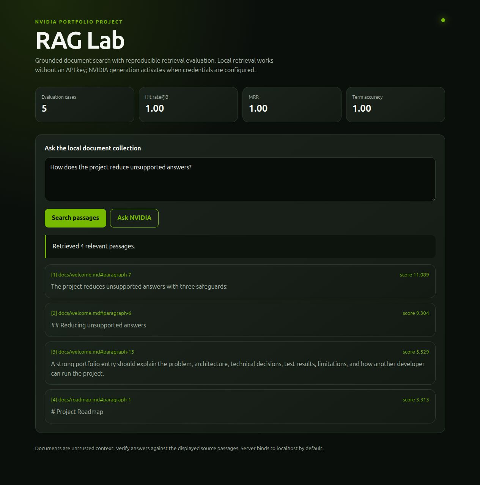

# DS-Pythone

DS-Pythone is a local-first developer agent for searching project documents, checking
retrieval quality and producing cited answers through an NVIDIA-hosted model. It is
buildable with Python's standard library and a reproducible evaluation set.

## Author and project context

Created by **Khandaker Readul Islam**, founder of **DearSoft** in Dhaka, Bangladesh.
The wider DS-Pythone ecosystem includes:

- [DS-Pythone showcase](https://github.com/dearsoft-bd/ds-pythone-showcase) — Python e-commerce CMS.
- [DS-Pythone core](https://github.com/dearsoft-bd/ds-pythone-core) — reusable Python foundations.
- [DearSoft SaaS](https://github.com/dearsoft-bd/DearSoft-SaaS) — hosted DS-Pythone, DS-Panel and ERP platform.
- [DS-Panel](https://github.com/dearsoft-bd/ds-panel) — open-source Python web hosting control panel.

## What you can demonstrate to an internship recruiter

- Python source-code organization
- Local document ingestion and retrieval
- NVIDIA NIM API integration
- Prompt construction with source grounding
- Reproducible retrieval evaluation
- Automated tests
- Clear setup instructions and reproducible evidence

## Architecture

```text
docs/*.md
   |
   v
paragraph chunks -> BM25-style lexical ranking -> grounded prompt
                                                -> NVIDIA NIM API
                                                -> cited answer + sources
```



## Quick start

Requirements: Python 3.10 or newer and an NVIDIA API key from the NVIDIA API Catalog.

```bash
git clone https://github.com/dearsoft-bd/nvidia-rag-portfolio.git
cd nvidia-rag-portfolio

# Test retrieval without a key or network call
python3 rag_cli.py --demo --question "How does this project reduce unsupported answers?"

# Configure the model when you are ready
cp .env.example .env
# Edit .env with your own key and a model currently offered in the API Catalog.

python3 rag_cli.py --question "How does this project reduce unsupported answers?"
```

The program loads `.env` automatically when the matching shell variables are not
already set. The answer is printed first, followed by the source passages used to
produce it.

## Use DS-Pythone

```bash
python3 ds_pythone.py
```

Useful commands:

```text
/status
/search How does retrieval work?
/metrics
/ask How can unsupported answers be reduced?
```

Without an NVIDIA API key, run `/search`, `/read` and `/metrics`; `/ask` reports that
the model is not configured. The agent has no arbitrary shell or write tools.

## API preflight

After adding a real key and a current model ID to `.env`, run:

```bash
python3 api_check.py
```

The checker reports the model, round-trip latency and a short response preview
without printing the API key. The test suite also uses a local mock OpenAI-compatible
server, so request and response handling can be verified without external credentials.

## Web interface

Start the local-only interface:

```bash
python3 webapp.py
```

Open `http://127.0.0.1:8765`. Retrieval search and evaluation metrics work without
an API key. The “Ask NVIDIA” action requires a configured key and model.

## Add your own documents

Put `.md` or `.txt` files inside `docs/`. Re-run the command after changing the documents.
Never add passwords, private documents, or API keys to the repository.

## Run tests

```bash
python3 -m unittest discover -s tests -v
python3 evaluate.py
```

The evaluation reports hit rate at K, mean reciprocal rank and top-result term
accuracy. It exits with a non-zero status when retrieval quality drops below the
configured baseline.

## GPU PC workflow

The project is also available on the Ubuntu GPU PC at:

```text
/home/dearsoft/projects/nvidia-rag
```

Connect from the development laptop with:

```bash
ssh gpu-pc
cd ~/projects/nvidia-rag
python3 -m unittest discover -s tests -v
python3 evaluate.py
```

The GeForce GT 610 is suitable for desktop graphics, not modern local LLM
inference. Use NVIDIA's remote API for model calls or a newer GPU when available.

## Suggested project upgrades

1. Ingest PDFs and preserve page numbers as citation metadata.
2. Add an embedding-based retriever and compare it with this keyword baseline.
3. Expand the evaluation set and record retrieval metrics for every change.
4. Record a two-minute demo and link it from your resume.
5. Add an evaluation dashboard for latency and source-level accuracy.

## Training completed

- NVIDIA SONiC Essentials by NVIDIA — November 2026
- NVIDIA Cumulus Linux Essentials — November 2026

## Safety

- Keep `NVIDIA_API_KEY` in the environment or an ignored `.env` file.
- Treat retrieved text as untrusted data, not as instructions.
- Do not claim a certificate you have not earned or commit anyone else's work.
